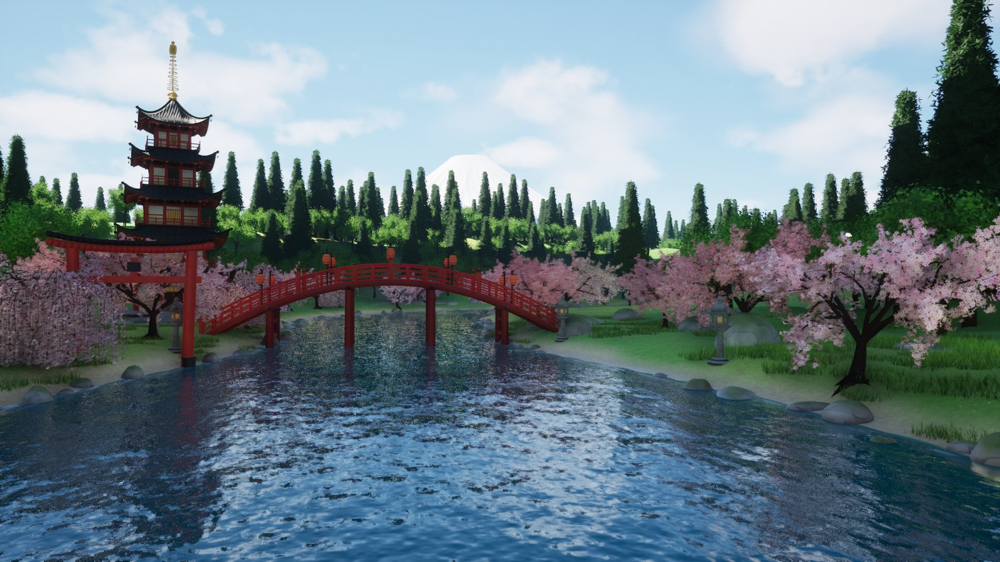

# Sakura River HD — Unreal Engine 5.8

An interactive Japanese-style stream background, the HD edition of the browser version [sakura-river](https://github.com/JakubJakubiak/sakura-river).
It is a standalone program (a 1920×1080 window) that you add to OBS with **Game Capture / Window Capture** or receive over **NDI**. It reacts to Twitch chat:
every message floats down the river, commands change the time of day and the weather, and subs, bits and raids launch fireworks.

## Highlights

- **Water**: Single Layer Water with real light absorption and scattering, a visible riverbed near the banks, Lumen reflections (hardware ray traced on RTX), shore foam and rain ripples.
- **Trees**: cherry trees whose blossoms are **real geometry** (about 22k five-petal flowers per tree, no alpha cards), a weeping cherry, broadleaf and sugi forest, and grass, all **Nanite**. Crowns use **Nanite Foliage voxels** (UE 5.7/5.8), so distant canopies turn into voxels instead of shimmering triangles.
- **Lighting**: Lumen GI and reflections, Virtual Shadow Maps and **MegaLights**, which give hundreds of shadowed lights: chat lanterns, stone lanterns, and firework bursts that light up the water. Also SkyAtmosphere, volumetric clouds, and volumetric fog with lantern halos at night.
- **RTX**: the `rtx` preset turns on hardware ray tracing in Lumen (reflections with hit lighting) and in MegaLights. It works on Windows RTX/RDNA2+ GPUs and on Apple M3 or newer (Metal SM6).
- **Chat**: Twitch with no login needed (anonymous IRC over WebSocket). Messages float on the water with full Unicode, Japanese included. Optional tōrō nagashi lanterns, one per viewer, each casting real light.

## Quick start (streamers)

1. Open `Sakura.ini` next to the program and set `channel = yourchannel` (without #).
2. Run `SakuraRiver`. A 1920×1080 window opens.
3. In OBS, add **Game Capture** (Windows) or **Window Capture / macOS Screen Capture → window** and pick “Sakura River HD”.

**Minimised window:** Slate normally stops drawing a minimised window. Sakura River HD overrides that (`minimized = 1`, the default), so OBS **Game Capture** on Windows and **NDI** (`ndi = 1`, OBS NDI Source via DistroAV) keep receiving frames while the window is minimised. macOS Window Capture (ScreenCaptureKit) never shows minimised windows, so on a Mac keep the window behind others or use NDI.

## Settings (`Sakura.ini` or command line)

`channel`, `time` (`dawn|day|sunset|night|19.5`), `cycle` (minutes per day), `view` (`river|fuji|bridge|bridge2|bridgeside|pagoda`),
`graphics` (`auto|low|medium|high|ultra|rtx|cinematic`), `text`, `lanterns`, `names`, `textsize`, `petals`, `fireflies`, `camera`, `cameraevery`,
`max`, `hold`, `cooldown`, `res`, `fullscreen`, `fps`, `ndi`, `ndiname`. Example: `SakuraRiver.exe -channel=you -time=night -graphics=rtx`.

## Chat commands

`!sakura` `!wind` `!rain` `!fireworks` (`!hanabi`) `!dawn` `!day` `!sunset` `!night` `!bridge` `!river` `!fuji` `!pagoda` (Polish aliases work too).

## Keys

`1–4` time of day · `←/→` view · `F` fireworks · `P` petals · `R` rain · `W` wind · `T` test message · `L` lanterns · `N` names · `G` graphics preset · `F11` fullscreen · `H` status bar and help

## Building from source

See the Polish [README.md](README.md#dla-twórcy-budowanie-z-repo-macos). In short: `Tools/build_models.sh`, `Tools/build_code.sh`, `Tools/build_content.sh`, `Tools/run.sh`.
