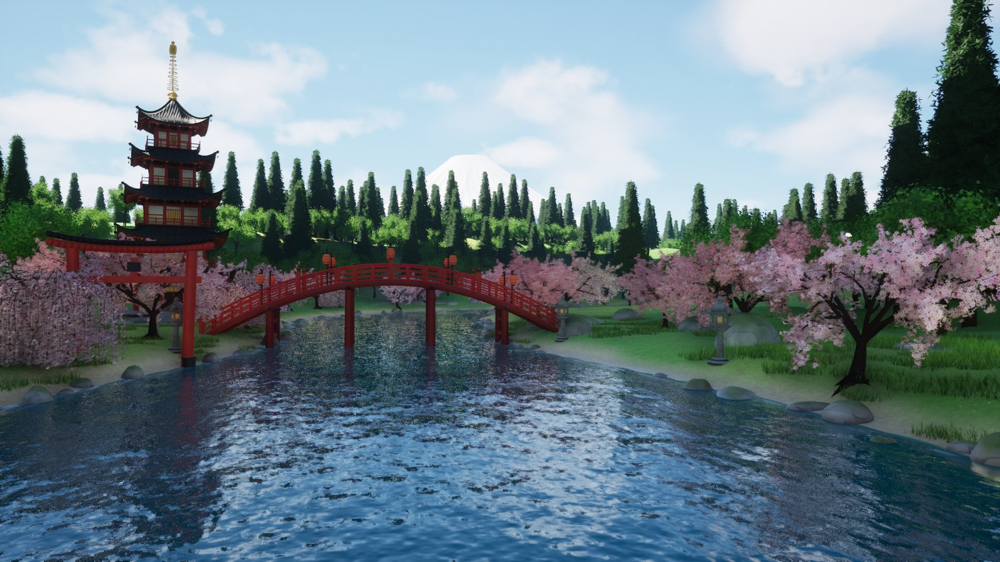
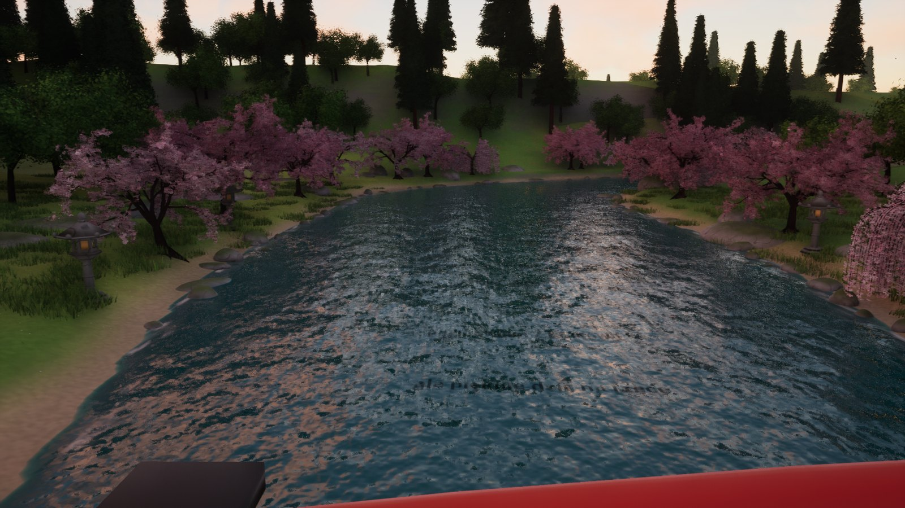
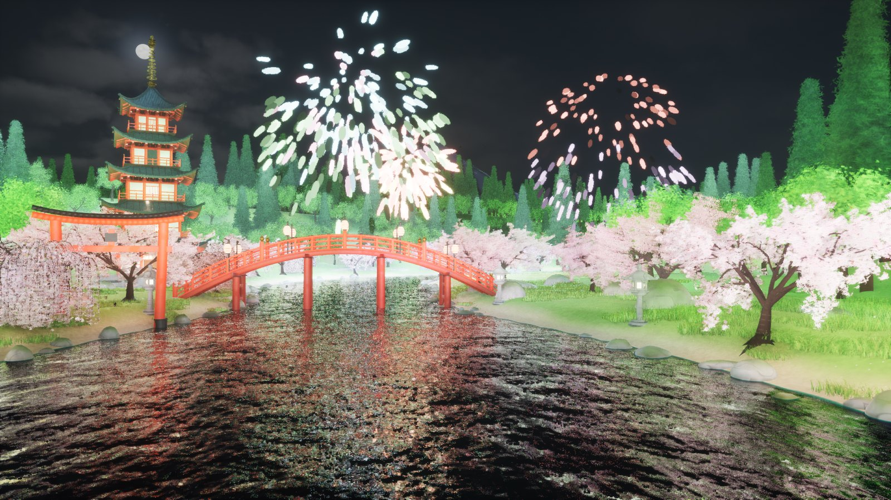

# Sakura River HD — Unreal Engine 5.8

Interaktywne tło na stream w japońskim stylu, wersja HD wersji przeglądarkowej [sakura-river](https://github.com/JakubJakubiak/sakura-river).
To osobny program (okno 1920×1080), który dodaje się w OBS jako **Przechwytywanie gry/okna** albo przez **NDI**. Reaguje na czat Twitcha:
każda wiadomość płynie rzeką, komendy zmieniają porę dnia i pogodę, suby, bity i raidy odpalają fajerwerki.



| Zachód z mostu | Noc z fajerwerkami |
|---|---|
|  |  |

## Co w nim jest

| | |
|---|---|
| **Woda** | Single Layer Water: prawdziwe pochłanianie i rozpraszanie światła, widać dno przy brzegu, odbicia z Lumena (na RTX sprzętowy ray tracing), piana przy brzegach, kręgi deszczu |
| **Drzewa** | wiśnie z kwiatami jako **prawdziwa geometria** (ok. 22 tys. kwiatów po 5 płatków na drzewo, bez kart z przezroczystością), płacząca wiśnia, las liściasty i cedry sugi, kępy trawy, wszystko w **Nanite**. Korony mają tryb **Nanite Foliage (woksele)**, czyli nowy sposób renderu roślin z UE 5.7/5.8: z daleka korona zamienia się w woksele zamiast w migoczące trójkąty |
| **Światło** | Lumen (GI i odbicia), Virtual Shadow Maps, **MegaLights**: setki świateł z cieniami (lampiony z czatu, latarnie, wybuchy fajerwerków oświetlające wodę), SkyAtmosphere, chmury wolumetryczne, mgła wolumetryczna (poświata wokół lampionów nocą) |
| **RTX** | preset `rtx`: sprzętowy ray tracing w Lumenie (odbicia z oświetleniem w miejscu trafienia) i w MegaLights. Na Windows z kartą RTX/RDNA2+, na Macu z Apple M3 i nowszymi (Metal SM6) |
| **Scena** | rzeka z zakrętami, pagoda, łukowy most z lampionami, torii w wodzie, kamienne latarnie, Fuji i pasma gór, cykl dnia i nocy z księżycem i gwiazdami, płatki, deszcz, świetliki, fajerwerki |
| **Czat** | Twitch bez logowania (anonimowy IRC przez WebSocket); wiadomości jako napisy na wodzie (pełny Unicode, także japoński), opcjonalnie lampiony tōrō nagashi, po jednym na osobę, z prawdziwym światłem |

Wszystkie materiały są proceduralne (HLSL w [Shaders/Sakura.ush](Shaders/Sakura.ush)), bez tekstur, a modele powstają skryptami Blendera. Całą treść da się odtworzyć z tekstu w repo.

## Uruchomienie (dla streamera)

1. Rozpakuj paczkę i otwórz `Sakura.ini` obok programu. Wpisz `channel = twojkanal` (bez #).
2. Uruchom `SakuraRiver` (Windows: `SakuraRiver.exe`, macOS: `SakuraRiver.app`). Otworzy się okno 1920×1080.
3. W OBS: **Źródła → + → Przechwytywanie gry** (Windows) albo **Przechwytywanie okna** / **macOS Screen Capture → okno** i wybierz „Sakura River HD”.

### Zminimalizowane okno
Silnik (Slate) normalnie przestaje rysować zminimalizowane okno. Sakura River HD to wyłącza: przy `minimized = 1` (domyślnie) program rysuje dalej także po zminimalizowaniu.
- **Windows + OBS „Przechwytywanie gry”**: obraz idzie dalej przy zminimalizowanym oknie (OBS przechwytuje klatki, które gra wysyła na ekran).
- **NDI** (`ndi = 1`, w OBS źródło **NDI Source**, wtyczka [DistroAV](https://github.com/DistroAV/DistroAV) i NDI Runtime): obraz idzie siecią lokalną, okno może być gdziekolwiek.
- **macOS „Przechwytywanie okna”** (ScreenCaptureKit) nie pokazuje zminimalizowanych okien niezależnie od programu. Na Macu zasłoń okno innymi albo użyj NDI.

## Ustawienia (`Sakura.ini` albo linia poleceń)

| klucz | wartości | opis |
|---|---|---|
| `channel` | nick | kanał Twitcha; pusty = tryb demo |
| `time` | `dawn` `day` `sunset` `night` albo godzina (`19.5`) | pora dnia |
| `cycle` | minuty | pełna doba w tylu minutach (0 = stała pora) |
| `view` | `river` `fuji` `bridge` `bridge2` `bridgeside` `pagoda` | punkt widokowy (rzeka zawsze w kadrze) |
| `graphics` | `auto` `low` `medium` `high` `ultra` `rtx` `cinematic` | jakość; `auto`: PC z kartą RT → `rtx`, PC bez RT → `ultra`, Mac → `high` |
| `text` / `lanterns` / `names` | 0/1 | napisy na wodzie / lampiony ze światłem / nicki |
| `textsize` | 0.4–3 | wielkość napisów |
| `petals` / `fireflies` | 0/1 | płatki / świetliki nocą |
| `camera`, `cameraevery` | 0/1, minuty | przeloty kamery między widokami |
| `max` | liczba | ile wiadomości naraz na rzece |
| `hold` | sekundy | ile trzyma się pora dnia ustawiona z czatu |
| `cooldown` | sekundy | globalny cooldown komend (mod, VIP i streamer omijają) |
| `res`, `fullscreen`, `fps` | `1920x1080`, 0/1, liczba | okno i limit klatek |
| `minimized` | 0/1 | rysuj dalej po zminimalizowaniu okna (domyślnie 1) |
| `ndi`, `ndiname` | 0/1, nazwa | wyjście NDI |

Przykład: `SakuraRiver.exe -channel=twojkanal -time=night -view=bridge -graphics=rtx`

## Komendy czatu

`!sakura` (płatki), `!wiatr`, `!deszcz` (włącza/wyłącza), `!hanabi` (fajerwerki), `!swit` `!dzien` `!zachod` `!noc`, `!most` `!rzeka` `!fuji` `!pagoda` (widok). Działają też angielskie (`!wind !rain !fireworks !dawn !day !sunset !night !bridge !river`).
Bity (od 100), suby, gifty i raidy odpalają fajerwerki samoczynnie.

## Wydajność (zmierzona)

Apple M5 (10 rdzeni GPU), 1920×1080, uruchomienie z edytora (paczka Shipping jest szybsza):

| preset | GPU / klatkę |
|---|---|
| `high` (75% rozdzielczości + TSR, sprzętowy RT) | 50–55 ms w dzień, 65 ms nocą z fajerwerkami |
| `rtx` (100%, RT, odbicia z oświetleniem trafień) | ok. 150 ms |

Najwięcej kosztują: Lumen GI, cienie chmur (tylko w `cinematic`), wiśnie, odbicia wody i mgła wolumetryczna. Trawa, las, kamienie i wiatr w Nanite razem to ok. 2 ms. Pomiar w każdej chwili: `Tools/run.sh -bench` (wypisuje koszt każdego elementu).

## Klawisze (w oknie programu)

`1–4` pora dnia · `←/→` widok · `F` fajerwerki · `P` płatki · `R` deszcz · `W` wiatr · `T` testowa wiadomość · `L` lampiony · `N` nicki · `G` kolejny preset grafiki · `F11` pełny ekran · `H` pasek stanu i pomoc

## Dla twórcy: budowanie z repo (macOS)

Wymagania: Unreal Engine 5.8 (Epic Launcher), Xcode z **Metal Toolchain** (`xcodebuild -downloadComponent MetalToolchain`), Blender 5.x.

```bash
Tools/build_models.sh      # Blender bez okna → Tools/out/*.fbx (teren, Fuji, drzewa, budowle, efekty), ok. 20 s
Tools/build_code.sh        # kompilacja C++
Tools/build_content.sh     # materiały + import modeli + mapa (commandlet UE)
Tools/run.sh -demo         # uruchomienie w oknie
Tools/shots.sh "day@river,night@bridge"   # zrzuty testowe do Saved/SakuraShots + czasy klatek
```

Struktura:
- `Source/SakuraRiver`: `SakuraWorld` (teren, woda, niebo, światło, roślinność), `SakuraDirector` (czat, napisy, lampiony, fajerwerki, kamera, presety), `SakuraTwitch` (IRC), `SakuraConfig` (`Sakura.ini`), `SakuraLayout` (plan rzeki i wysokość terenu, te same wzory co w web i w Blenderze).
- `Source/SakuraShaders`: rejestruje `Shaders/` jako `/Project` dla materiałów.
- `Shaders/Sakura.ush`: cały kod materiałów (teren, woda, kora, budowle, wiatr, płatki, deszcz, świetliki, niebo nocą).
- `Tools/blender`: generatory modeli; `Tools/blender/legacy`: pagoda i most z wersji web.
- `Tools/ue/build_content.py`: MPC, materiały, import z ustawieniami Nanite, mapa.

Paczka dla Windows musi powstać na komputerze z Windows (UE 5.8, Visual Studio 2022):
`RunUAT BuildCookRun -project=SakuraRiver.uproject -platform=Win64 -clientconfig=Shipping -build -cook -stage -pak -archive -archivedirectory=Dist`.
